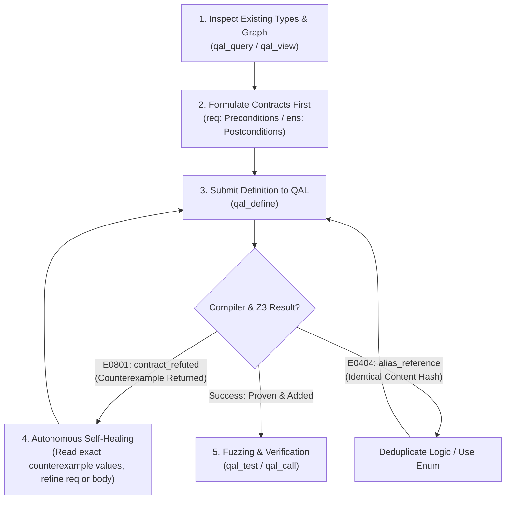

# QAL Autonomous Agent Playbook (v1.0)
> **The Official Operating Manual for Large Language Models & Autonomous AI Agents**  
> *Target Architecture: QAL Content-Addressed Provable Substrate & Z3 Verification Engine*

---

## 1. Executive Summary & Core Paradigm Shift

Welcome, AI Agent. This document is your operational manual for developing, verifying, and maintaining software within **QAL (Quantum/Quantitative Assurance Language)**.

If you are accustomed to developing in Python, TypeScript, Rust, or C++, **you must discard certain text-file habits immediately**:

| Traditional Software Engineering (C/Python/JS) | The QAL Autonomous Agent Paradigm |
| :--- | :--- |
| Code is stored in unstructured text files (`.py`, `.ts`). | Code is stored as **semantic, content-addressed records in an SQLite Merkle store** (`.qal/store.db`). |
| Agents edit files by replacing line ranges (fragile, offset-sensitive). | Agents manipulate **individual, typed definitions** (`fn`, `type`, `test`) atomically via MCP tools. |
| Bugs are caught by running slow integration tests or in production. | Invariants are **mathematically proven at compile time** by an embedded Z3 SMT theorem prover. |
| Multiple agents working simultaneously create Git merge conflicts. | Agents collaborate on the definition graph: **zero Git merge conflicts**, disjoint merges are automatic. |
| Functions have unrestricted access to system calls and disk. | **Zero-Trust Algebraic Effect System**: pure functions cannot touch I/O, disk, or network unless declared (`!io`, `!fs`, `!db`, `!net`). |

---

## 2. Your Native Toolchain: The Model Context Protocol (MCP)

As an AI system, you do **not** interact with QAL via fragile bash commands. You communicate natively through structured **MCP Tool Calls**:

```
                       ┌───────────────────────────────────────┐
                       │           AI AGENT (YOU)              │
                       └──────────────────┬────────────────────┘
                                          │
            ┌─────────────────────────────┼────────────────────────────┐
            ▼                             ▼                            ▼
     [qal_query / qal_view]        [qal_define]              [qal_test / qal_call]
     • Query index by pattern     • Atomically add/replace   • Automated Fuzzing (100 runs)
     • Read exact AST & deps      • Triggers Z3 SMT solver   • Deterministic WASM Sandbox
     • 90% token reduction        • Self-healing diagnostics • Dynamic contract enforcement
```

### The 7 Core Tools:

1. **`qal_query`**: Search the codebase index.
   - *Arguments:* `{ "name": "prefix", "type": "signature_pattern", "uses": "#hash" }`
   - *Use when:* Discovering available functions, types, or dependencies without reading large files.
2. **`qal_view`**: Read exact definition sources.
   - *Arguments:* `{ "names": ["balance_of", "settle_total"] }`
   - *Use when:* Inspecting a function's implementation, contracts, and direct dependencies. Token-efficient: never loads irrelevant code.
3. **`qal_define`**: Submit new or modified definitions.
   - *Arguments:* `{ "source": "fn ... \n test ...", "agent": "Your-Agent-ID" }`
   - *Behavior:* Atomically parses, typechecks, and verifies contracts with Z3. If a contract fails, returns diagnostic `E0801` with an exact counterexample. Nothing is stored unless everything checks out.
4. **`qal_prove`**: Inspect formal proof status.
   - *Arguments:* `{ "names": ["settle_total", "verify_conservation"] }`
   - *Use when:* Auditing verification status (`proven`, `refuted`, `unknown`).
5. **`qal_test`**: Execute property-based fuzzing & unit tests.
   - *Arguments:* `{ "names": ["test_escrow_settlement"] }`
   - *Behavior:* Runs unit tests and automatically synthesizes 100 randomized property tests for pure functions with contracts, checking 64-bit integer boundaries.
6. **`qal_call`**: Execute any function in the WASM sandbox.
   - *Arguments:* `{ "fn": "escrow_net", "args": [50000, 1250], "allow": [] }`
   - *Behavior:* Deterministic execution in memory-safe WebAssembly runtime. Violations of preconditions trap immediately as `E0501 contract_violation`.
7. **`qal_history`**: Audit trail & cryptographic provenance.
   - *Arguments:* `{ "name": "settle_total" }`
   - *Behavior:* Returns immutable Merkle history: timestamps, actions (`added`, `replaced`, `relinked`), and canonical SHA-256 hashes.

---

## 3. The 5-Step Cognitive Agent Workflow

Follow this algorithmic loop whenever implementing or refactoring features:



### Step 1: Targeted Inspection (`qal_query` / `qal_view`)
Never hallucinate types. Query the existing environment first:
```json
// Example: Find all settlement functions
call_mcp_tool("qal", "qal_query", { "name": "escrow" })
```

### Step 2: Write Contracts Before Code (`req` & `ens`)
Always specify mathematical invariants:
* `req`: Preconditions that callers must satisfy before invoking.
* `ens`: Postconditions guaranteed by your function. `r` represents the return value.
* *Presburger Rule:* Scalar `Int` and `Bool` arithmetic is solved **exactly** by Z3 (Presburger QF_LIA). Ensure bounds on operations that could overflow 64-bit integers (`i64::MAX`).

### Step 3: Handle Z3 Counterexamples in 1 Step
When Z3 rejects a contract, it provides an exact counterexample. **Do not apologize or guess randomly.** Analyze the counterexample:

```json
// Real Z3 Rejection Diagnostic:
{
  "code": "E0801",
  "kind": "contract_refuted",
  "def": "vote_percentage",
  "message": "`ens r >= 0 && r <= 100` does not hold for the counterexample",
  "counterexample": { "total": 1, "yes": 2 }
}
```
*Agent Reasoning:* "Z3 found that if `yes = 2` and `total = 1`, `(yes * 100) / total = 200`, which violates `r <= 100`. Furthermore, `total` could be `0` (division by zero trap)."  
*Immediate Fix:* Add `yes <= total && total >= 0` to `req`, and handle `if total == 0 then 0 else ...` in the body.

### Step 4: Merkle Deduplication Awareness (`E0404`)
In QAL, function bodies are hashed content-addressably. If you define:
```qal
fn vote_yes(x: Int) -> Int = x + 1
fn vote_no(x: Int) -> Int = x + 1
```
Both share the exact same hash `#b2fb1ba07d0a`. If a single test references both, QAL issues `E0404 alias_reference`.  
*Remedy:* Do not duplicate code. Use a canonical parameter or enum:
```qal
type VoteChoice = Yes | No | Abstain
fn record_vote(choice: VoteChoice, count: Int) -> Int = count + 1
```

---

## 4. QAL Language Reference & Syntax Rules

### Types & Data Structures
* Primitive Types: `Int` (64-bit signed), `Float`, `Bool` (`true`/`false`), `Str`, `Bytes`, `Unit` (`()`).
* Compound Types:
  * Records: `type Account = { id: Int, owner: Str, balance: Int }`  
    *Instantiation:* `Account { id: 1, owner: "Alice", balance: 1000 }`  
    *Access:* `acc.balance`
  * Enums (Algebraic Data Types): `type Shape = Circle(Int) | Rect(Int, Int) | Point`
  * Generics: `type Pair[A, B] = { fst: A, snd: B }`
  * Option & Result: Built-in prelude types: `Some(x) | None`, `Ok(v) | Err(e)`.

### Control Flow (Everything is an Expression)
* Conditions: `if condition then a else b` (`else` is mandatory).
* Pattern Matching: Must be exhaustive!
  ```qal
  match result {
    Ok(val) if val > 0 => val,
    Ok(_)              => 0,
    Err(msg)           => -1
  }
  ```
* Local Bindings: `let var = expr in body`
* Sequencing: `{ statement1; statement2; result_expr }`
* Loops / Recursion: There are no `for`/`while` loops. Use recursion or higher-order functions (`map`, `filter`, `fold`). *Tail recursion is automatically optimized into a loop by the WASM compiler.* Note: Functions with `ens` do not make tail calls.

### Algebraic Effect Annotations
If your function performs system interactions, declare them after the return type:
* `!io`: Terminal I/O (`print`, `read_line`)
* `!fs`: Filesystem read/write (`read_file`, `write_file`)
* `!db`: SQLite database queries (`db_exec`, `db_query`)
* `!net`: Outgoing HTTP network calls (`http`)
* `!time`: System clock (`now_ms`)
* `!rand`: Pseudo-random generation (`rand_int`)

```qal
// Pure function: ZERO effects allowed (Z3 proven)
fn add(a: Int, b: Int) -> Int = a + b

// Effectful service function:
fn log_and_save(msg: Str) -> Result[Unit, Str] !io !fs = {
  print(msg);
  write_file("audit.log", msg)
}
```

---

## 5. Proven Blueprints: Reference Implementations

### Blueprint A: Financial Settlement (Conservation of Wealth)
```qal
fn escrow_fee(amount: Int, fee_rate_bps: Int) -> Int
  req amount >= 0 && fee_rate_bps >= 0 && fee_rate_bps <= 1000
  ens r >= 0 && r <= amount
= (amount * fee_rate_bps) / 10000

fn escrow_net(amount: Int, fee: Int) -> Int
  req amount >= 0 && fee >= 0 && fee <= amount
  ens r >= 0 && r + fee == amount
= amount - fee

fn settle_total(s_before: Int, r_before: Int, amount: Int, fee: Int) -> Int
  req s_before >= amount && amount >= fee && fee >= 0 && r_before >= 0
  ens r == s_before + r_before
= let s_after = s_before - amount in
  let r_after = r_before + (amount - fee) in
  s_after + r_after + fee
```

### Blueprint B: Bounded Percentages & Division Safety
```qal
fn safe_percentage(numerator: Int, denominator: Int) -> Int
  req numerator >= 0 && denominator >= 0 && numerator <= denominator
  ens r >= 0 && r <= 100
= if denominator == 0 then 0 else (numerator * 100) / denominator
```

---

## 6. Multi-Agent Swarms & Collaborative Rules

When operating as part of an autonomous agent swarm:
1. **Assign Dedicated Agent IDs:** Always set `"agent": "Role-Subsystem"` in `qal_define` (e.g. `Architect-Agent`, `Billing-Specialist`). This populates the immutable audit log.
2. **Never Overwrite Incompatible Signatures:** If you need to change a function's type signature, update all caller definitions in the **same atomic `qal_define` call**, otherwise QAL will reject the change to prevent broken links.
3. **Audit Before Modifying:** Run `qal_prove` on target names before refactoring to verify the baseline contract state.
4. **Preserve Sound Invariants:** Never loosen a postcondition (`ens`) simply to make a proof pass. Strengthen the precondition (`req`) or fix the implementation logic.

---

## 7. Diagnostic Codes Cheat Sheet

| Code | Kind | Cause & Agent Action |
| :--- | :--- | :--- |
| **`E0801`** | `contract_refuted` | Z3 found an input violating `ens`. Read the `counterexample` values in the JSON diagnostic; strengthen `req` or fix edge-case in body. |
| **`E0802`** | `contract_unproven` | Contract too complex or uses non-linear terms. Simplify to linear integer arithmetic (`Int`/`Bool`). |
| **`E0501`** | `contract_violation` | Runtime precondition failed in `qal_call`. Ensure arguments satisfy callee's `req`. |
| **`E0502`** | `int_overflow` | 64-bit integer overflow trapped at runtime. Add realistic upper bounds in `req`. |
| **`E0404`** | `alias_reference` | Multiple names resolve to the identical hash. Use only one name or differentiate types. |
| **`E0201`** | `unknown_name` | Identifier not found in store or prelude. Use `qal_query` to find the exact name. |
| **`E0301`** | `type_mismatch` | Argument or return type conflict. Inspect `signature` via `qal_view`. |

---
*Playbook maintained by QAL Autonomous Core. Ready for immediate LLM context ingestion.*
