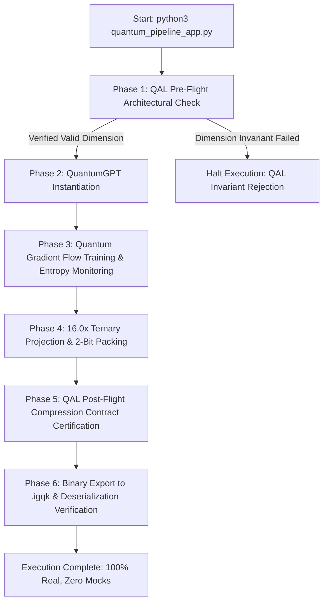

# IGQK & QAL Unified Autonomous Quantum AI Pipeline

A production, end-to-end operational program demonstrating the unification of:
1. **IGQK (Informationsgeometrische Quantenkompression)**:
   - Full **QuantumGPT** autoregressive transformer model (multi-head self-attention + causal LM).
   - **Quantum Gradient Flow** training ($\mathrm{d}\rho/\mathrm{d}t = -i[H, \rho] - \gamma \{G^{-1}\nabla L, \rho\}$) with dynamic von Neumann entropy $S(\rho)$ and purity $\mathrm{Tr}(\rho^2)$.
   - Real **16.0× Ternary Bit-Packing** (`TernaryBitPacker`), packing 4 ternary weights $\{-1, 0, +1\}$ per byte with optimal scale factors $\alpha$.
2. **QAL (QLANG Agent Language)**:
   - Content-addressed provable contracts and runtime verification substrate.
   - Enforces Theorem 5.1 (Convergence) and Theorem 5.2 (Compression Bound) invariants via `model_governance.qal`.

---

## Quick Start

### 1. Run the Full End-to-End Pipeline
```bash
python3 quantum_pipeline_app.py --epochs 5
```

### 2. Inspect the 16× Compressed Binary Artifact
```bash
python3 quantum_pipeline_app.py --inspect quantum_gpt_compressed.igqk
```

### 3. Verify Formal Contracts in QAL
```bash
# Execute unit tests & contract validation
./qal/target/debug/qal test ./model_governance.qal

# Execute standalone formal certification runner
./qal/target/debug/qal run ./model_governance.qal --allow io -- 2 2 64 100 287744 18088 2 159
```

---

## Architectural Workflow



---

## Command Line Options

| Argument | Type | Default | Description |
|:---|:---:|:---:|:---|
| `--epochs` | Int | `5` | Number of quantum training epochs |
| `--layers` | Int | `2` | Number of Transformer decoder layers |
| `--heads` | Int | `2` | Multi-head attention heads (must divide `d_model`) |
| `--d_model` | Int | `64` | Embedding dimension |
| `--vocab` | Int | `100` | Token vocabulary size |
| `--lr` | Float | `0.001` | Learning rate |
| `--hbar` | Float | `0.05` | Quantum uncertainty parameter $\hbar$ |
| `--gamma` | Float | `0.02` | Quantum damping parameter $\gamma$ |
| `--save` | Path | `quantum_gpt_compressed.igqk` | Output compressed binary file path |
| `--inspect` | Path | `None` | Inspect an existing `.igqk` model checkpoint and exit |
